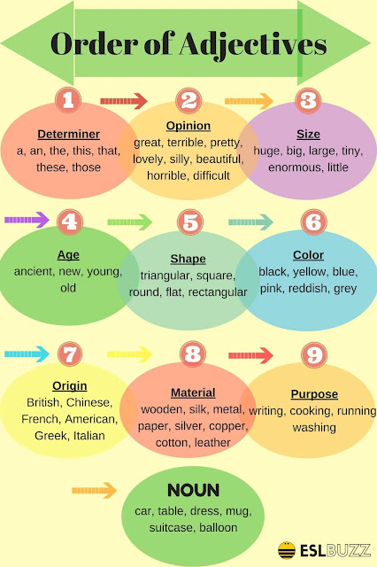

#### **D.OSAS.COMP**

1. **Determiner**: a, an, the, this, that, these, those
2. **Opinion**: great, terrible, pretty, lovely, silly, beautiful, horrible, difficult
3. **Size**: huge, big, large, tiny, enormous, little
4. **Age**: ancient, new, young, old
5. **Shape**: triangular, square, rectangular, flat, round
6. **Color**: red, yellow, blue, green, reddish
7. **Origin**: Chinese, British, American, Greek, Vietnamese
8. **Material**: wooden, silk, metal, paper, silver, copper, cotton, leather
9. **Purpose**: writing, cooking, running, washing

Ex: She found a **lovely**, **tiny**, **old**, **round**, **green**, **French**, **wooden**, **jewelry** box in the attic.